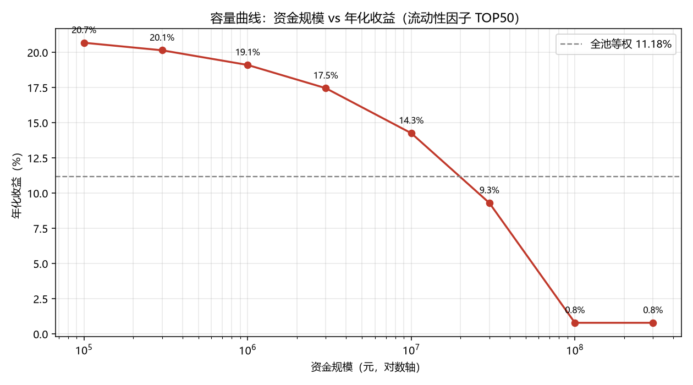

# A股量化最小闭环：从回测到证伪

> 一个本科生用五周时间，用真实数据跑通量化研究全流程，然后诚实地证明这个策略不行。

## 一句话结论

沪深300 + 动量/低波因子，回测年化 **12.86%**、夏普 **0.75**、最大回撤 **-27.4%** —— 看起来是个不错的策略。

但把这个结果拆开之后：换成全市场股票池会掉到 2.93%，把动量方向搞对反而更差，最后找到一个真正有效的因子（IR 0.586），却发现它只能装 2000 万。

**这个项目真正的产出不是策略，是五条可以复用的判断。**

## 五个实验

| 周 | 问题 | 结论 |
|---|---|---|
| 1 | 股票池偏差有多大？ | 换成全 A 后年化从 14.86% 掉到 2.93%，收益主要来自「成分股本身选得好」 |
| 2 | 因子到底有没有用？ | 动量在 A 股是**反向**因子，IC -0.066、IR -0.45，2019-2026 每年都为负 |
| 3 | 分层 15% 为什么进了组合只剩 2%？ | 集中度 -4~5%、成本 -3.5%、换手 -6%，三段损耗；且没有配置跑赢全池等权 |
| 4 | 换一个因子呢？ | 流动性因子 IR 0.586、分层完美单调（22.72%），但滑点 50bp 就跌破等权 |
| 5 | 它能装多少钱？ | 约 2000 万；1000 万以内年化 14%+，1 亿归零 |

## 几张关键图表

**动量分层：第 10 层（动量最高）年化 -8%，第 1 层 +15%，完全单调**


**容量曲线：超过 2000 万，超额收益就被滑点吃光**



## 项目结构

```
quant_min/
├── config.py            全部参数（区间、因子窗口、持仓数、成本）
├── download.py          沪深300 数据下载（东财/腾讯/新浪多源兜底）
├── download_all.py      全市场 5200+ 只下载（新浪源）
├── factors.py           因子计算 + 截面标准化
├── backtest.py          事件循环回测（T+1、次日开盘、成本模型）
├── metrics.py           绩效指标
├── run.py               主流程：数据 -> 因子 -> 回测 -> 报告
├── run_all.py           通用回测入口（可换股票池、可反向）
├── factor_ic.py         Rank IC + 10 层分层回测
├── sensitivity.py       参数敏感性扫描
├── portfolio_lab.py     组合构建实验（持仓数/成本/频率）
├── liquidity_lab.py     流动性因子 + 滑点敏感性
├── capacity.py          容量分析（资金规模 vs 净收益）
├── compare.py           两个股票池对比
├── docs/
│   ├── 研究日志.md       五周的问题、做法、结论和踩坑记录
│   └── 1000元实盘学习方案.md
└── reports*/            每次实验的文字报告与图表
```

## 快速开始

```bash
pip install -r requirements.txt

# 沪深300 池，三因子回测
python download.py          # 约 40 秒
python run.py               # 生成 reports/report.md

# 全市场对比
python download_all.py      # 约 8 分钟，5200+ 只
python run_all.py --panel data_all/panel.csv.gz --universe data_all/universe.csv \
    --out reports_all --min-amount 1000
python compare.py

# 因子有效性
python factor_ic.py --panel data_all/panel.csv.gz --universe data_all/universe.csv \
    --out reports_ic/all --min-amount 1000

# 组合与容量
python portfolio_lab.py
python liquidity_lab.py
python capacity.py
```

## 关键设计（防未来函数）

1. **信号与成交分离**：月末收盘算因子，**次一交易日开盘**才成交
2. **不用当日收盘价成交**：换仓日收益从「开盘买入」算到「收盘」
3. **因子只用历史数据**：所有 rolling 窗口都是向后看的
4. **停牌处理**：前收盘前向填充，成交日开盘价缺失的票不买入
5. **样本内外切分**：2022 年底之前为样本内，参数没有在样本外调过
6. **成本模型**：佣金 2.5bp 双边 + 印花税 5bp（卖出）+ 滑点 10bp 单边

## 已知局限

- **幸存者偏差**：沪深300 版本用的是当前成分股；全 A 版本是在市股票，历史退市股仍缺失
- **数据源**：新浪源不复权，绝对收益被系统性低估约 2-2.5%/年；东财前复权会把高分红股算成负价格
- **成本估算**：冲击成本用平方根模型近似，未建模涨跌停无法成交、单笔最低佣金
- **未做行业中性化**：动量因子在特定年份会押注单一板块

## 踩过的坑（都写在研究日志里）

- **回测里某年收益恰好为 0，几乎总是 bug**：上市满 250 天的过滤写成了全局滚动窗口，把 2019 年整年筛空了
- **前复权会算出负价格**：6 只高分红股（000408、601225 等）被东财算成负价，制造出几百个百分点的假收益
- **分层收益 ≠ 组合收益**：第 1 层 500 只等权年化 15%，集中到 50 只只剩 1.9%
- **IR 0.586 的因子也可能一文不值**：流动性因子赚的钱正好等于交易摩擦

## 我学到的

1. 回测好看不代表策略有效，**先和「全池等权」比**，再谈 alpha
2. **IC 和分层告诉你有没有信息，不告诉你能不能赚到钱**
3. 每个因子都有**容量上限**，能规模化赚钱的 alpha 早就被赚走了
4. A 股的动量和美股相反，照搬海外论文的因子方向会稳定亏钱
5. 负结果也是结果，而且比正结果更可靠

## 数据来源

东方财富、腾讯、新浪的公开行情接口，无需 API key。数据不随仓库分发，运行下载脚本即可重新获取。

---

*这个项目是一个学习方法论的练习。策略本身不构成任何投资建议。*
