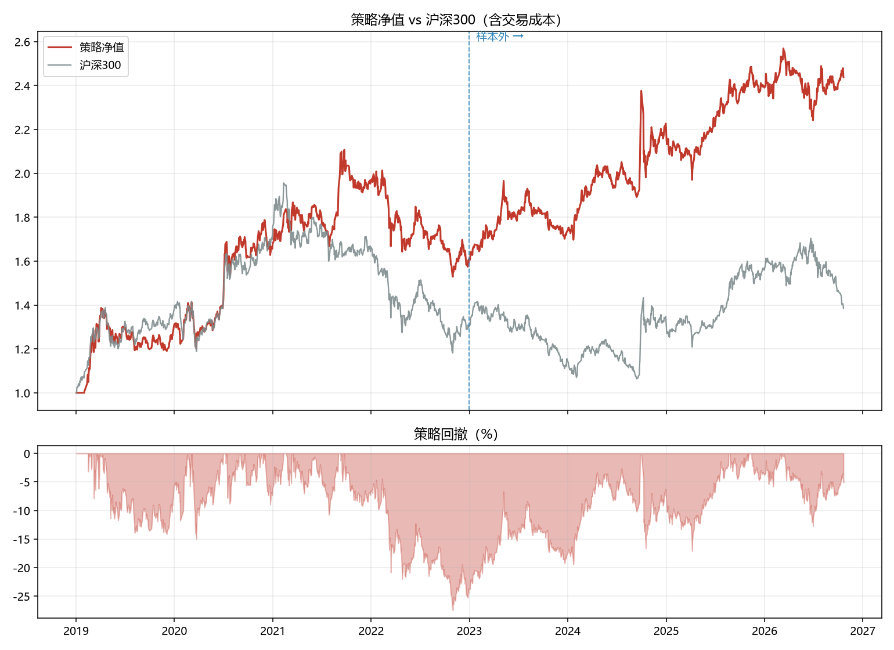
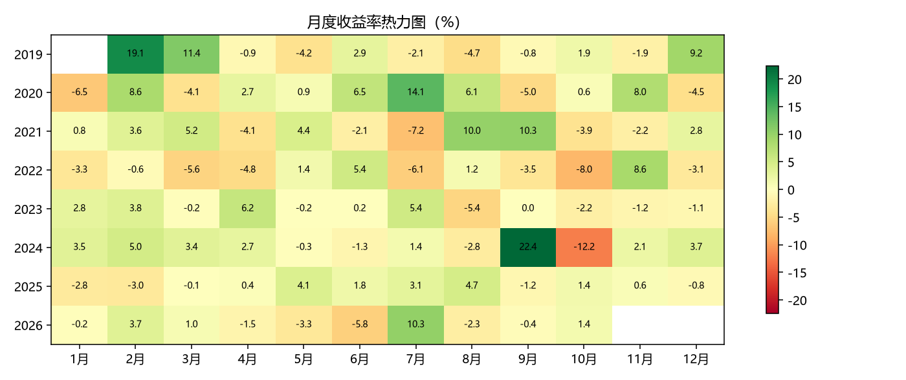
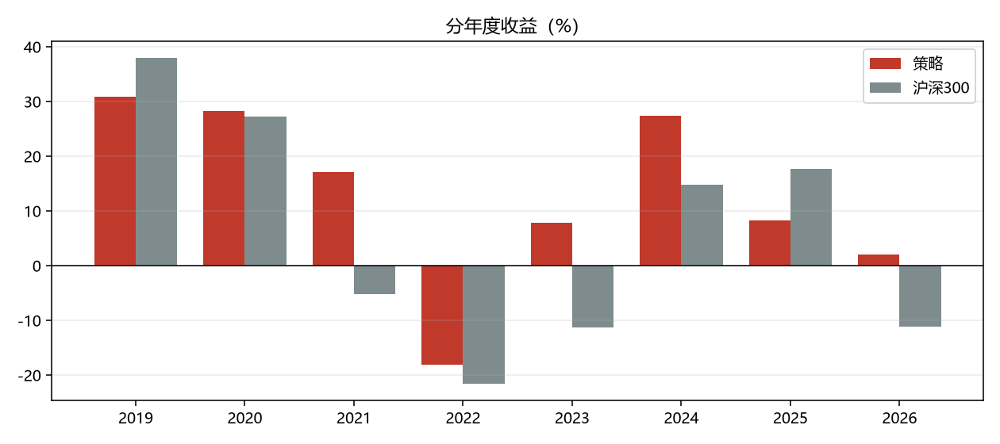

# 最小量化闭环回测报告

## 策略设定

- 股票池：沪深300 成分股（300 只），剔除 ST 与低流动性
- 因子：20 日动量 + 60 日低波动 + 20 日低换手，等权合成 z-score
- 持仓：每月末打分取前 50 名，等权
- 执行：月末收盘出信号，**次一交易日开盘**成交（T+1，无未来函数）
- 成本：佣金 2.5bp、印花税 5.0bp（卖出）、滑点 10.0bp

## 绩效摘要

**策略**

| 指标 | 样本内 | 样本外 | 全期 |
|---|---|---|---|
| 累计收益 | 60.91% | 51.83% | 143.80% |
| 年化收益 | 13.12% | 12.15% | 12.62% |
| 年化波动 | 20.78% | 15.23% | 18.28% |
| 夏普比率 | 0.6977 | 0.8299 | 0.7416 |
| 最大回撤 | -27.44% | -17.09% | -27.44% |
| Calmar | 0.4783 | 0.7108 | 0.4598 |
| 日胜率 | 49.43% | 51.91% | 50.61% |
| 月胜率 | 51.06% | 53.33% | 52.69% |
| 年均单边换手 | 269.44% | 283.91% | 276.47% |

**沪深300 基准（同期）**

| 指标 | 样本内 | 样本外 | 全期 |
|---|---|---|---|
| 累计收益 | 30.38% | 5.76% | 38.47% |
| 年化收益 | 7.12% | 1.55% | 4.44% |
| 年化波动 | 20.48% | 17.40% | 19.04% |
| 夏普比率 | 0.4388 | 0.1753 | 0.3233 |
| 最大回撤 | -39.59% | -24.80% | -45.60% |
| Calmar | 0.1798 | 0.0625 | 0.0973 |
| 日胜率 | 51.70% | 49.40% | 50.61% |
| 月胜率 | 55.32% | 46.67% | 51.61% |

## 分年度收益

| 年份 | 策略 | 沪深300 |
|---|---|---|
| 2019 | 30.85% | 37.95% |
| 2020 | 28.26% | 27.21% |
| 2021 | 17.11% | -5.20% |
| 2022 | -18.13% | -21.63% |
| 2023 | 7.84% | -11.38% |
| 2024 | 27.30% | 14.68% |
| 2025 | 8.20% | 17.66% |
| 2026 | 2.01% | -11.19% |

## 交易统计

- 调仓次数：93
- 平均持仓：50.0 只
- 累计成本占比：12.42%
- 单次调仓平均成本：0.1335%

## 图表

