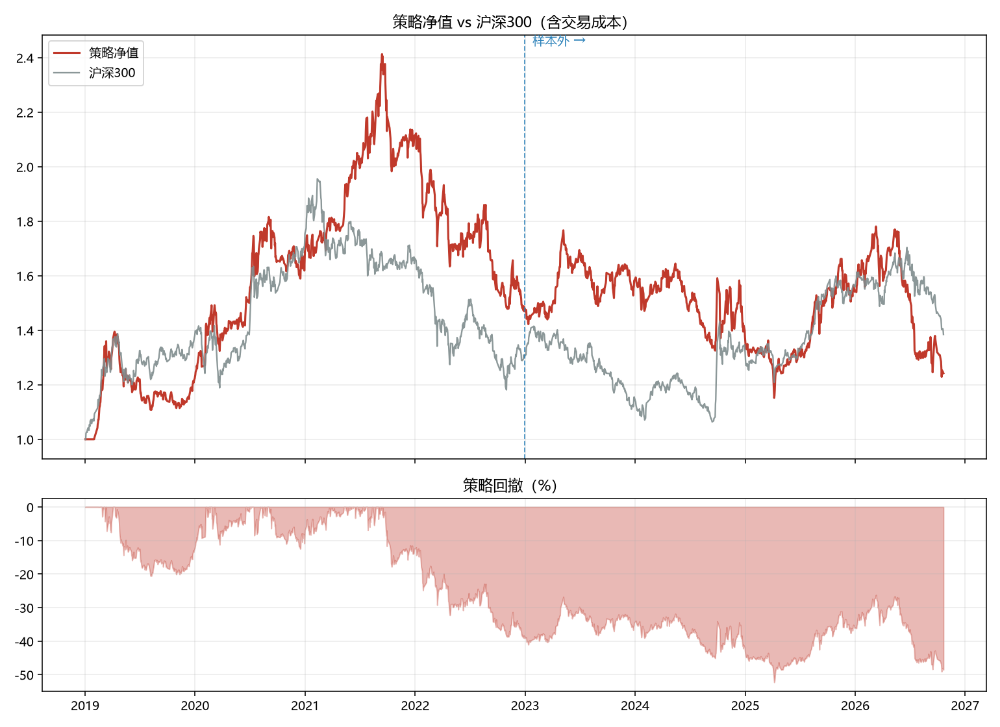
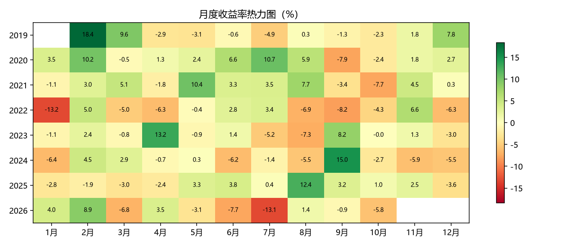

# 两因子回测（动量 + 低波）

- 股票池：5223 只
- 流动性门槛：20 日均成交额 ≥ 1000.0 万元
- 因子：20 日动量 + 60 日低波，等权合成

## 绩效

| 指标 | 样本内 | 样本外 | 全期 |
|---|---|---|---|
| 累计收益 | 48.15% | -15.36% | 24.22% |
| 年化收益 | 10.73% | -4.47% | 2.93% |
| 年化波动 | 22.15% | 21.37% | 21.77% |
| 夏普比率 | 0.5716 | -0.1072 | 0.2421 |
| 最大回撤 | -39.11% | -34.82% | -52.27% |
| Calmar | 0.2743 | -0.1285 | 0.0561 |
| 日胜率 | 52.21% | 52.34% | 52.25% |
| 月胜率 | 55.32% | 44.44% | 49.46% |
| 年均单边换手 | 574.41% | 609.44% | 591.43% |

## 分年度

| 年份 | 策略 | 沪深300 |
|---|---|---|
| 2019 | 22.30% | 37.95% |
| 2020 | 38.17% | 27.21% |
| 2021 | 25.02% | -5.20% |
| 2022 | -29.87% | -21.63% |
| 2023 | 6.74% | -11.38% |
| 2024 | -13.01% | 14.68% |
| 2025 | 12.44% | 17.66% |
| 2026 | -19.69% | -11.19% |

## 图表

