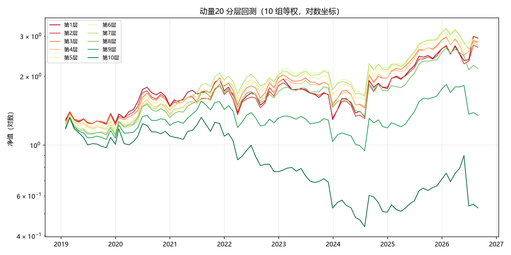
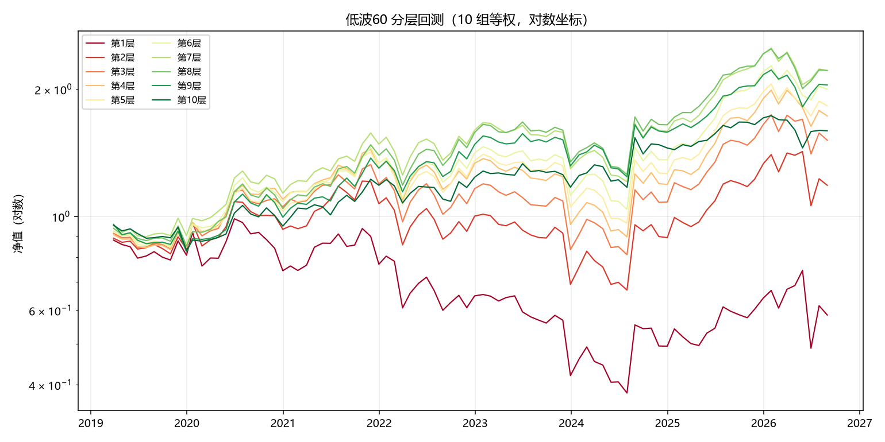
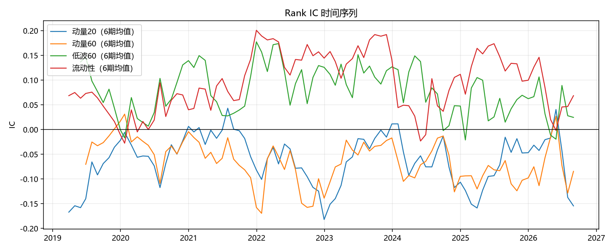

# 因子有效性分析

- 股票池：5223 只
- 调仓：月末信号，次日开盘成交
- 分层：按因子值分 10 组等权

## Rank IC 汇总

IR = IC均值 / IC标准差。一般认为 |IR| > 0.3 且 IC>0 占比稳定高于 50% 才算可用。

| 因子 | IC均值 | IC标准差 | IR | IC>0占比 | 样本数 |
|---|---|---|---|---|---|
| 动量5 | -0.0461 | 0.1173 | -0.3928 | 0.3587 | 92.0000 |
| 动量10 | -0.0562 | 0.1309 | -0.4294 | 0.3152 | 92.0000 |
| 动量20 | -0.0660 | 0.1457 | -0.4534 | 0.3370 | 92.0000 |
| 动量60 | -0.0667 | 0.1517 | -0.4399 | 0.3371 | 89.0000 |
| 动量120 | -0.0578 | 0.1573 | -0.3672 | 0.3721 | 86.0000 |
| 低波60 | 0.0787 | 0.1948 | 0.4040 | 0.6111 | 90.0000 |
| 流动性 | 0.0957 | 0.1635 | 0.5855 | 0.7609 | 92.0000 |

## 分年度 IC 均值

| 因子 | 动量5 | 动量10 | 动量20 | 动量60 | 动量120 | 低波60 | 流动性 |
|---|---|---|---|---|---|---|---|
| 2019 | -0.0611 | -0.0728 | -0.0811 | -0.0123 | 0.0302 | 0.0580 | 0.0311 |
| 2020 | -0.0189 | -0.0292 | -0.0337 | -0.0278 | -0.0075 | 0.0867 | 0.0294 |
| 2021 | -0.0161 | -0.0493 | -0.0418 | -0.1081 | -0.0862 | 0.1027 | 0.1517 |
| 2022 | -0.0829 | -0.0816 | -0.1108 | -0.0909 | -0.1147 | 0.0873 | 0.1271 |
| 2023 | -0.0595 | -0.0792 | -0.0037 | -0.0345 | -0.0138 | 0.1389 | 0.1553 |
| 2024 | -0.0224 | -0.0060 | -0.0912 | -0.0797 | -0.1006 | 0.0511 | 0.0505 |
| 2025 | -0.0149 | -0.0438 | -0.0703 | -0.0899 | -0.0792 | 0.0437 | 0.1365 |
| 2026 | -0.1160 | -0.1036 | -0.1106 | -0.0821 | -0.0405 | 0.0470 | 0.0785 |

## 分层年化收益

**动量20**

| 分组 | 年化收益 |
|---|---|
| 全池等权 | 11.18% |
| 第1层 | 15.26% |
| 第2层 | 13.89% |
| 第3层 | 14.62% |
| 第4层 | 14.58% |
| 第5层 | 14.82% |
| 第6层 | 15.52% |
| 第7层 | 14.24% |
| 第8层 | 10.68% |
| 第9层 | 4.02% |
| 第10层 | -8.02% |

**低波60**

| 分组 | 年化收益 |
|---|---|
| 全池等权 | 6.99% |
| 第1层 | -6.98% |
| 第2层 | 2.31% |
| 第3层 | 5.75% |
| 第4层 | 7.64% |
| 第5层 | 8.45% |
| 第6层 | 9.78% |
| 第7层 | 11.29% |
| 第8层 | 11.29% |
| 第9层 | 10.13% |
| 第10层 | 6.48% |

**流动性**

| 分组 | 年化收益 |
|---|---|
| 全池等权 | 11.18% |
| 第1层 | -1.30% |
| 第2层 | 1.36% |
| 第3层 | 4.22% |
| 第4层 | 6.89% |
| 第5层 | 9.71% |
| 第6层 | 11.97% |
| 第7层 | 14.98% |
| 第8层 | 19.21% |
| 第9层 | 21.01% |
| 第10层 | 22.72% |

## 图表

