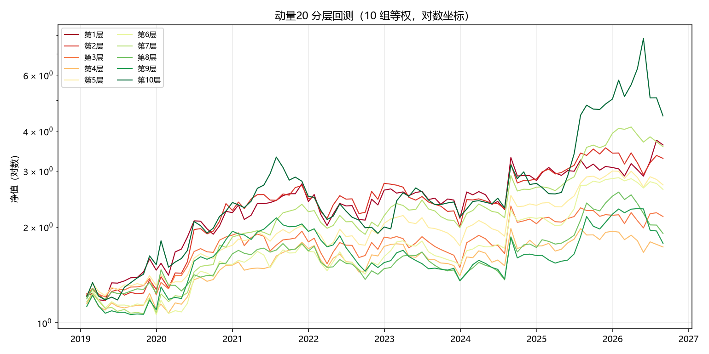
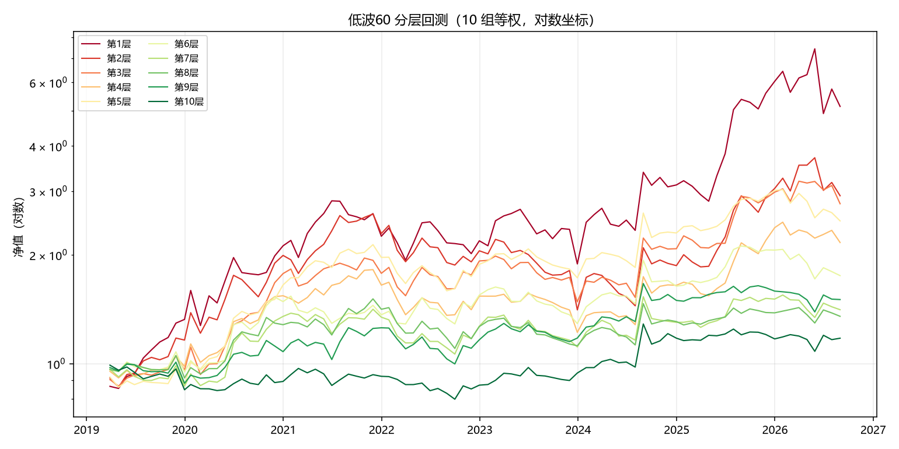
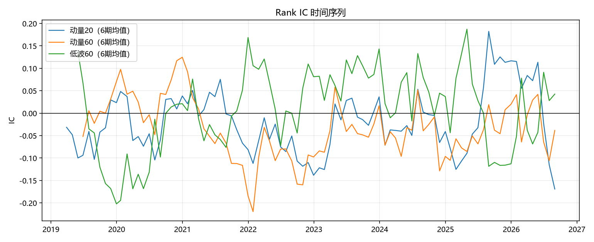

# 因子有效性分析

- 股票池：300 只
- 调仓：月末信号，次日开盘成交
- 分层：按因子值分 10 组等权

## Rank IC 汇总

IR = IC均值 / IC标准差。一般认为 |IR| > 0.3 且 IC>0 占比稳定高于 50% 才算可用。

| 因子 | IC均值 | IC标准差 | IR | IC>0占比 | 样本数 |
|---|---|---|---|---|---|
| 动量5 | -0.0276 | 0.1992 | -0.1387 | 0.4891 | 92.0000 |
| 动量10 | -0.0346 | 0.1941 | -0.1784 | 0.4891 | 92.0000 |
| 动量20 | -0.0262 | 0.2058 | -0.1272 | 0.5326 | 92.0000 |
| 动量60 | -0.0353 | 0.2081 | -0.1698 | 0.4831 | 89.0000 |
| 动量120 | -0.0111 | 0.2278 | -0.0488 | 0.4884 | 86.0000 |
| 低波60 | 0.0114 | 0.2869 | 0.0396 | 0.4889 | 90.0000 |

## 分年度 IC 均值

| 因子 | 动量5 | 动量10 | 动量20 | 动量60 | 动量120 | 低波60 |
|---|---|---|---|---|---|---|
| 2019 | -0.0445 | -0.0292 | -0.0353 | 0.0297 | 0.0685 | -0.0943 |
| 2020 | 0.0021 | -0.0173 | -0.0038 | 0.0606 | 0.1057 | -0.0552 |
| 2021 | 0.0187 | -0.0048 | -0.0222 | -0.1260 | -0.0543 | 0.0602 |
| 2022 | -0.0369 | -0.0949 | -0.1068 | -0.0888 | -0.1009 | 0.0044 |
| 2023 | -0.0632 | -0.0525 | 0.0323 | -0.0122 | 0.0427 | 0.1309 |
| 2024 | -0.0541 | -0.0647 | -0.0453 | -0.0672 | -0.0628 | 0.0098 |
| 2025 | 0.0836 | 0.0289 | 0.0422 | -0.0242 | -0.0319 | -0.0425 |
| 2026 | -0.1763 | -0.0463 | -0.0925 | -0.0399 | -0.0186 | 0.0843 |

## 分层年化收益

**动量20**

| 分组 | 年化收益 |
|---|---|
| 全池等权 | 14.65% |
| 第1层 | 18.50% |
| 第2层 | 16.99% |
| 第3层 | 10.68% |
| 第4层 | 7.51% |
| 第5层 | 14.07% |
| 第6层 | 13.58% |
| 第7层 | 18.30% |
| 第8层 | 8.90% |
| 第9层 | 7.88% |
| 第10层 | 21.82% |

**低波60**

| 分组 | 年化收益 |
|---|---|
| 全池等权 | 11.34% |
| 第1层 | 24.69% |
| 第2层 | 15.49% |
| 第3层 | 14.70% |
| 第4层 | 10.95% |
| 第5层 | 13.03% |
| 第6层 | 7.84% |
| 第7层 | 4.73% |
| 第8层 | 4.14% |
| 第9层 | 5.65% |
| 第10层 | 2.20% |

## 图表

