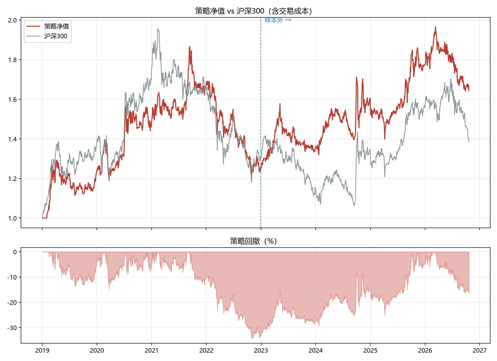
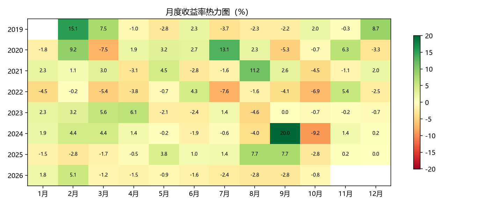

# 两因子回测（动量 + 低波）

- 股票池：300 只
- 流动性门槛：20 日均成交额 ≥ 2000.0 万元
- 因子：20 日动量 + 60 日低波，等权合成

## 绩效

| 指标 | 样本内 | 样本外 | 全期 |
|---|---|---|---|
| 累计收益 | 25.66% | 31.17% | 64.35% |
| 年化收益 | 6.10% | 7.73% | 6.85% |
| 年化波动 | 18.26% | 16.25% | 17.31% |
| 夏普比率 | 0.4160 | 0.5401 | 0.4696 |
| 最大回撤 | -34.46% | -18.28% | -34.46% |
| Calmar | 0.1771 | 0.4229 | 0.1988 |
| 日胜率 | 49.74% | 52.02% | 50.82% |
| 月胜率 | 44.68% | 46.67% | 46.24% |
| 年均单边换手 | 379.65% | 431.36% | 404.77% |

## 分年度

| 年份 | 策略 | 沪深300 |
|---|---|---|
| 2019 | 23.94% | 37.95% |
| 2020 | 19.71% | 27.21% |
| 2021 | 13.26% | -5.20% |
| 2022 | -25.22% | -21.63% |
| 2023 | 7.74% | -11.38% |
| 2024 | 16.50% | 14.68% |
| 2025 | 12.43% | 17.66% |
| 2026 | -7.32% | -11.19% |

## 图表

