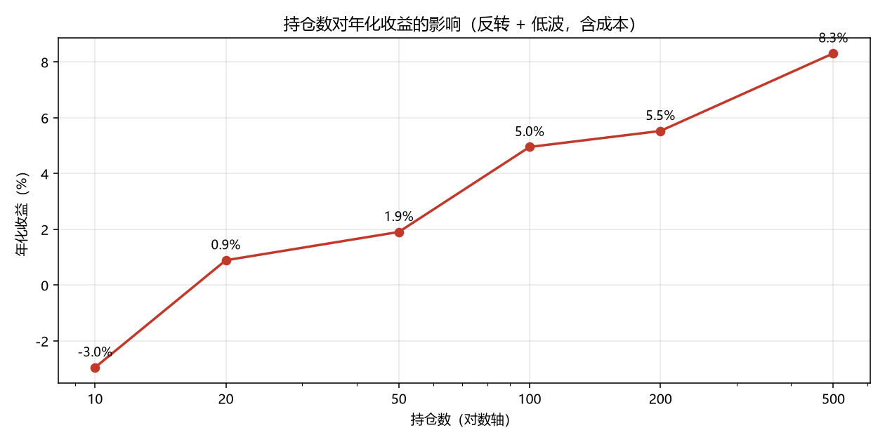

# 第 3 周：组合构建实验

因子方向用第 2 周验证过的「反转 + 低波」。

## 实验 1：持仓数

| 设置 | 年化收益 | 夏普 | 最大回撤 | 年均单边换手 | 累计成本 |
|---|---|---|---|---|---|
| TOP10 | -0.0295 | -0.0120 | -0.6116 | 6.0217 | 0.2707 |
| TOP20 | 0.0089 | 0.1515 | -0.4896 | 5.8503 | 0.2630 |
| TOP50 | 0.0191 | 0.1954 | -0.4651 | 5.6675 | 0.2548 |
| TOP100 | 0.0495 | 0.3405 | -0.4052 | 5.4499 | 0.2450 |
| TOP200 | 0.0553 | 0.3675 | -0.3947 | 5.1192 | 0.2301 |
| TOP500 | 0.0831 | 0.4976 | -0.3679 | 4.3527 | 0.1956 |

## 实验 2：成本开关（TOP50）

| 设置 | 年化收益 | 夏普 | 年均单边换手 | 累计成本 |
|---|---|---|---|---|
| 零成本 | 0.0543 | 0.3582 | 5.6675 | 0.0000 |
| 正常成本 | 0.0191 | 0.1954 | 5.6675 | 0.2548 |

## 实验 3：调仓频率（TOP50）

| 设置 | 年化收益 | 夏普 | 年均单边换手 | 累计成本 |
|---|---|---|---|---|
| 月度 | 0.0191 | 0.1954 | 5.6675 | 0.2548 |
| 季度 | 0.0792 | 0.4552 | 1.9310 | 0.0866 |

## 图

