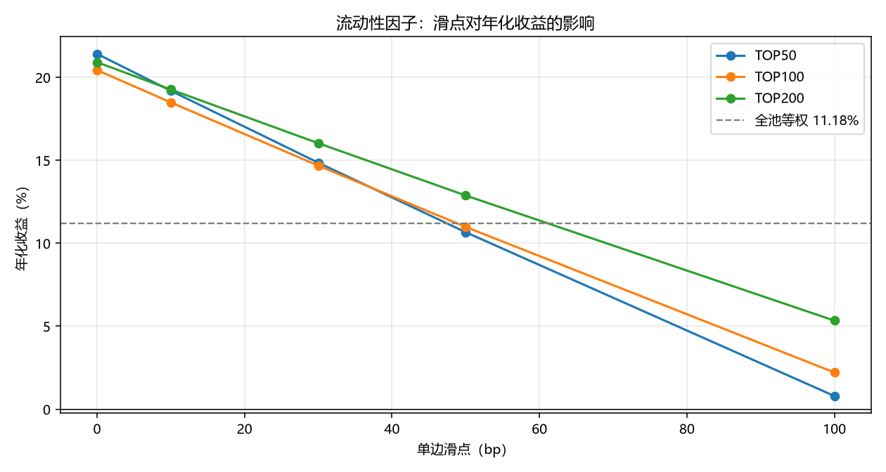

# 第 4 周：流动性因子的落地检验

因子：20 日均成交额越小，得分越高。

## 全表

| 持仓数 / 滑点 | 年化收益 | 夏普 | 最大回撤 | 年均单边换手 | 累计成本 |
|---|---|---|---|---|---|
| ('TOP50', '0bp') | 0.2141 | 0.9553 | -0.3755 | 4.6135 | 0.0690 |
| ('TOP50', '10bp') | 0.1919 | 0.8759 | -0.3778 | 4.6135 | 0.2074 |
| ('TOP50', '30bp') | 0.1486 | 0.7156 | -0.3877 | 4.6135 | 0.4842 |
| ('TOP50', '50bp') | 0.1066 | 0.5542 | -0.4218 | 4.6135 | 0.7610 |
| ('TOP50', '100bp') | 0.0079 | 0.1524 | -0.5635 | 4.6135 | 1.4530 |
| ('TOP100', '0bp') | 0.2043 | 0.9235 | -0.3783 | 4.0701 | 0.0608 |
| ('TOP100', '10bp') | 0.1849 | 0.8532 | -0.3803 | 4.0701 | 0.1829 |
| ('TOP100', '30bp') | 0.1468 | 0.7114 | -0.3843 | 4.0701 | 0.4271 |
| ('TOP100', '50bp') | 0.1098 | 0.5686 | -0.3882 | 4.0701 | 0.6713 |
| ('TOP100', '100bp') | 0.0221 | 0.2117 | -0.4593 | 4.0701 | 1.2818 |
| ('TOP200', '0bp') | 0.2091 | 0.9368 | -0.3794 | 3.4248 | 0.0511 |
| ('TOP200', '10bp') | 0.1926 | 0.8781 | -0.3812 | 3.4248 | 0.1539 |
| ('TOP200', '30bp') | 0.1603 | 0.7597 | -0.3847 | 3.4248 | 0.3594 |
| ('TOP200', '50bp') | 0.1288 | 0.6404 | -0.3883 | 3.4248 | 0.5648 |
| ('TOP200', '100bp') | 0.0534 | 0.3409 | -0.4105 | 3.4248 | 1.0786 |

## 图

## 怎么读

- 随着滑点从 0 加到 100bp，年化收益会一路下滑。
- 穿过「全池等权 11.18%」那条线之后，这个因子的超额收益就不存在了。
- 流动性因子选的是成交额最小的股票，真实滑点远高于 10bp。