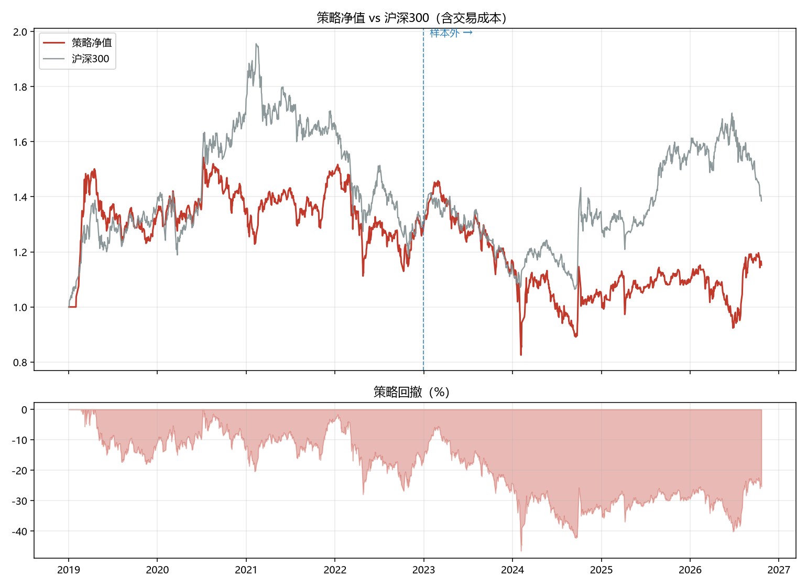
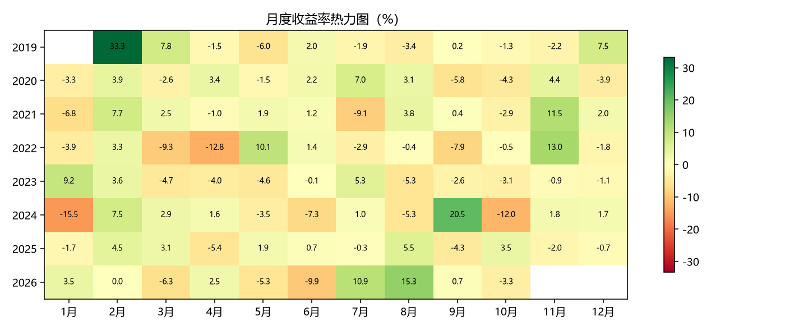

# 两因子回测（动量 + 低波）

- 股票池：5223 只
- 流动性门槛：20 日均成交额 ≥ 1000.0 万元
- 因子：20 日动量 + 60 日低波，等权合成

## 绩效

| 指标 | 样本内 | 样本外 | 全期 |
|---|---|---|---|
| 累计收益 | 28.37% | -12.20% | 15.22% |
| 年化收益 | 6.69% | -3.51% | 1.91% |
| 年化波动 | 19.27% | 22.44% | 20.88% |
| 夏普比率 | 0.4327 | -0.0464 | 0.1954 |
| 最大回撤 | -27.91% | -43.39% | -46.51% |
| Calmar | 0.2396 | -0.0809 | 0.0410 |
| 日胜率 | 50.15% | 51.91% | 51.03% |
| 月胜率 | 48.94% | 46.67% | 48.39% |
| 年均单边换手 | 541.18% | 593.82% | 566.75% |

## 分年度

| 年份 | 策略 | 沪深300 |
|---|---|---|
| 2019 | 33.66% | 37.95% |
| 2020 | 1.51% | 27.21% |
| 2021 | 9.84% | -5.20% |
| 2022 | -13.87% | -21.63% |
| 2023 | -8.87% | -11.38% |
| 2024 | -10.72% | 14.68% |
| 2025 | 4.31% | 17.66% |
| 2026 | 5.76% | -11.19% |

## 图表

